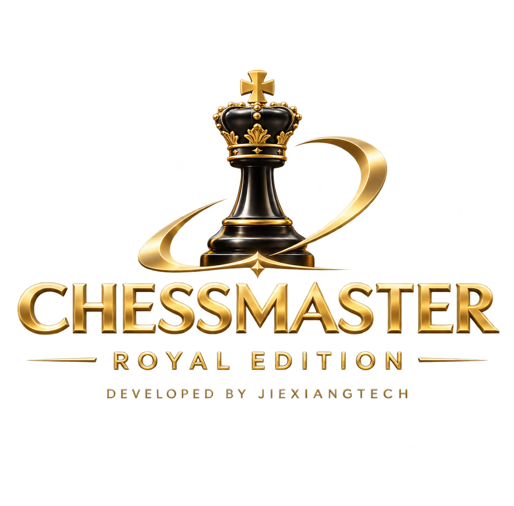
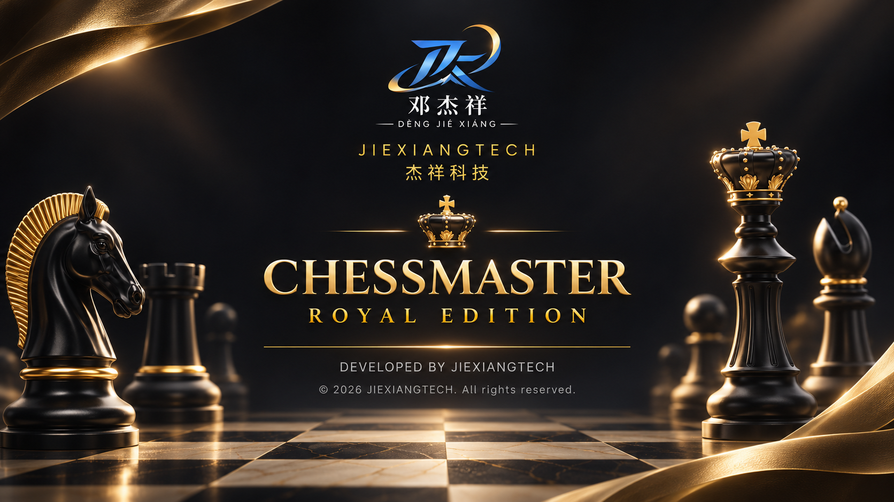
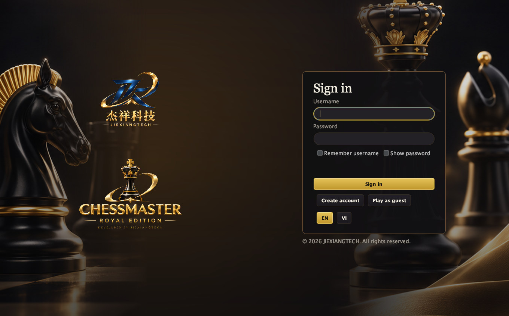
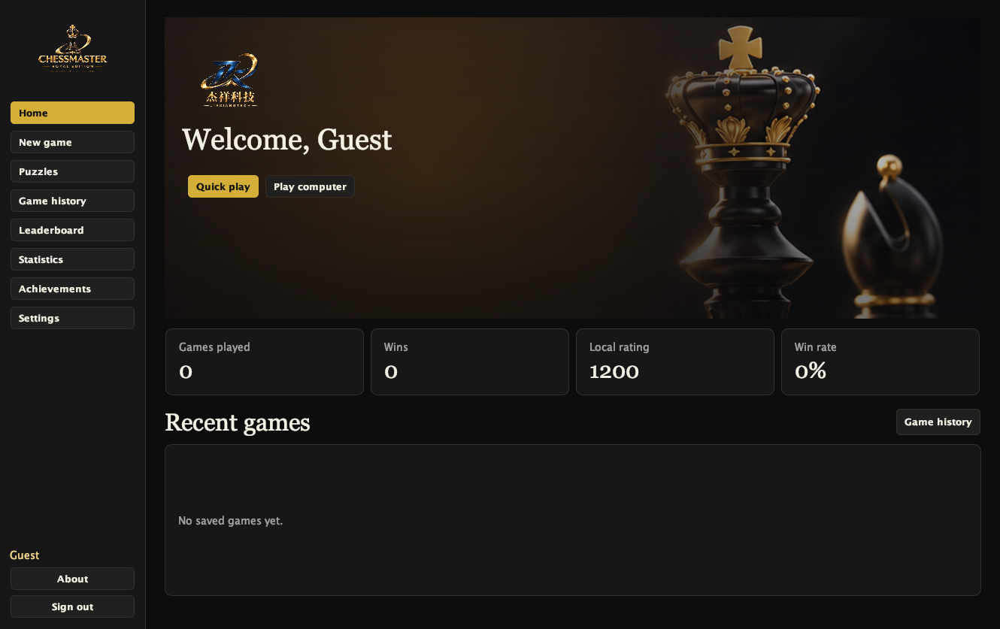
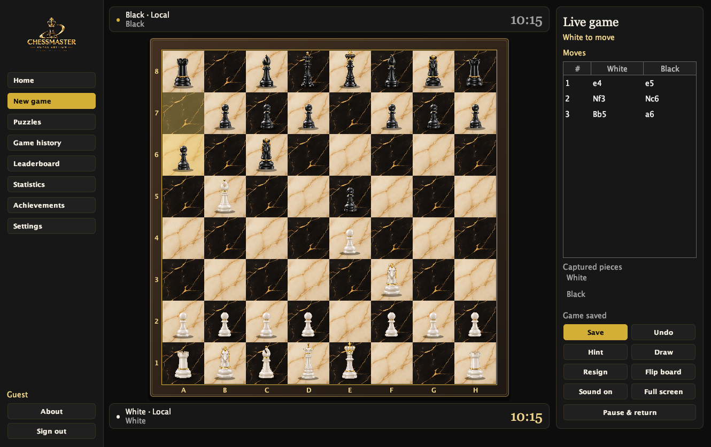
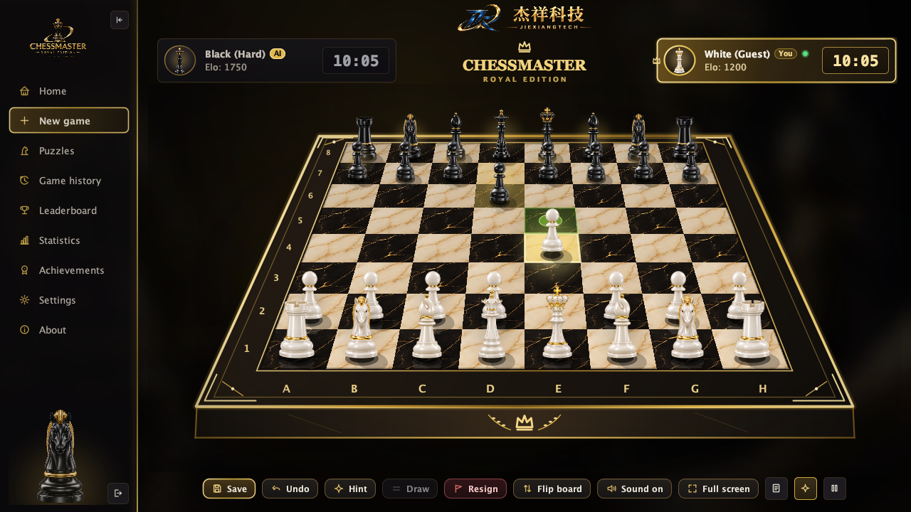
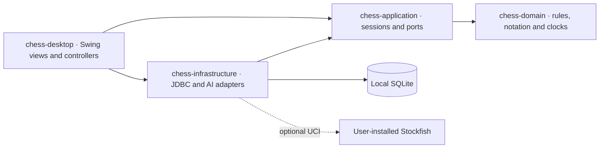

<p align="center">
  
  <br>
  
</p>

# ChessMaster – Royal Edition

ChessMaster is an offline desktop chess game developed by **JIEXIANGTECH (杰祥科技)**.
Play on a marble board with the supplied Royal Luxury pieces, switch between English and Vietnamese,
and keep games, preferences and puzzle progress in a local SQLite database.



## Play

- Play with two people on one computer or face four AI levels. Choose sides, a time control and increment.
- Move by clicking or dragging. The board shows legal destinations, the last move and check. Choose a piece when promoting.
- Sign in to a local profile or play as a guest. Live games can save after each move and resume with the clocks paused while the app is closed.
- Search and replay game history, analyze a position, and import or export a single PGN game.
- Solve four verified mate-in-one puzzles. Earn points on the first unassisted solve of each puzzle and unlock Royal Slate after three.
- View local rankings, match statistics and achievements. Hint and undo use marks a match as assisted and keeps it out of the rating calculation.

## Screenshots

These captures come from the macOS Swing application in both **Classic 2D** and **Royal Focus 2.5D** modes.

| Sign-in | Dashboard |
| --- | --- |
|  |  |

| Classic 2D Gameplay | Royal Focus 2.5D Gameplay |
| --- | --- |
|  |  |

## Download & install

Download pre-built desktop packages (with bundled Java 17 runtime) from the latest GitHub Release:

- **Latest Release (`v1.0.0`)**: [ChessMaster – Royal Edition v1.0.0](https://github.com/jtuongdang/jiexiangtech-royal-chess/releases/tag/v1.0.0)
  - **macOS (Apple Silicon)**: [royal-chess-macos-arm64.zip](https://github.com/jtuongdang/jiexiangtech-royal-chess/releases/download/v1.0.0/royal-chess-macos-arm64.zip)
  - **Windows (x64)**: [royal-chess-windows-x64.zip](https://github.com/jtuongdang/jiexiangtech-royal-chess/releases/download/v1.0.0/royal-chess-windows-x64.zip)
  - **Linux (x86_64)**: [royal-chess-linux-x86_64.tar.gz](https://github.com/jtuongdang/jiexiangtech-royal-chess/releases/download/v1.0.0/royal-chess-linux-x86_64.tar.gz)
  - **Portable JAR (All Platforms, JDK 17+)**: [royal-chess-1.0.0-all.jar](https://github.com/jtuongdang/jiexiangtech-royal-chess/releases/download/v1.0.0/royal-chess-1.0.0-all.jar)

On Apple Silicon, open `ChessMaster Royal.app` after extracting `royal-chess-macos-arm64.zip`. On Windows, extract `royal-chess-windows-x64.zip` and run `ChessMasterRoyal.exe`. On Linux, extract `royal-chess-linux-x86_64.tar.gz` and run `ChessMasterRoyal/bin/ChessMasterRoyal`.

From a checkout at the repository root:

```sh
mvn clean verify
java -jar chess-desktop/target/royal-chess-1.0.0-all.jar
```

On macOS, [build.sh](scripts/build.sh) and [run.sh](scripts/run.sh) select the installed Java 17 JDK when `JAVA_HOME` is unset. On Windows, run `scripts\run.bat` after Maven succeeds. Build native images with the bundled runtime on the host operating system:

| Host | Command |
| --- | --- |
| macOS | `scripts/package-macos.sh dist/macos-arm64 app-image` |
| macOS DMG | `scripts/package-macos.sh dist/macos-arm64 dmg` |
| Windows PowerShell | `./scripts/package-desktop.ps1 -Destination dist/windows` |
| Linux | `scripts/package-linux.sh dist/linux app-image` |

The Windows packaging script accepts `-Type msi` on a host with the JDK’s required installer tooling. The Linux script also accepts `deb` or `rpm` on a host with the corresponding package tools. Local macOS images are developer builds without Apple notarization.

In IntelliJ IDEA, open the root `pom.xml` as a Maven project, select JDK 17, let IntelliJ import all four modules, then run `com.jiexiangtech.chess.desktop.Main` with the `chess-desktop` module classpath.

## Technology and architecture

Java 17, Swing, Java2D and FlatLaf provide the desktop interface. Maven coordinates the four modules. SQLite JDBC handles local storage, SLF4J and Logback provide logging, and JUnit 5 with Mockito covers unit and integration behavior. Maven coordinates are `com.jiexiangtech:royal-chess`, and Java packages start with `com.jiexiangtech.chess`.



```text
.
├── pom.xml               Maven reactor
├── chess-domain          Rules, position, game, clock, notation and perft
├── chess-application     Accounts, game sessions, puzzles and ports
├── chess-infrastructure  SQLite migrations, hashing and AI implementations
├── chess-desktop         Swing UI, branding, localization and runtime assets
├── scripts               Build, launch, package and asset preparation
├── docs                  Requirements, architecture, schema and verification
└── .github/workflows     CI and tag-based releases
```

[Architecture](docs/ARCHITECTURE.md) · [Database design](docs/DATABASE.md) · [Game rules](docs/GAME_RULES.md) · [Design system](docs/DESIGN_SYSTEM.md) · [Asset manifest](docs/ASSET_MANIFEST.md)

## Chess engines

Easy chooses a random legal move. Medium runs minimax. Hard adds alpha-beta pruning. Expert adds iterative deepening, capture extensions and a longer search budget. Evaluation considers material, piece-square tables, mobility, center control, king safety, pawn structure and undefended pieces. Analysis displays a measured engine score from White’s perspective and search depth.

Expert and replay analysis can use a separately installed Stockfish executable over UCI. Add `stockfish` to `PATH` or set `CHESSMASTER_STOCKFISH` to its executable path before launching. The application uses its built-in engine when the configured executable is absent or cannot produce a valid result within its budget. The proprietary app and the optional GPL engine are distributed independently. [Stockfish project](https://github.com/official-stockfish/Stockfish) · [Third-party notices](THIRD_PARTY.md)

## Verification and roadmap

`mvn clean verify` runs domain, session, repository and rendering tests. The initial-position perft suite verifies **20**, **400**, **8,902** and **197,281** nodes. CI repeats verification on macOS, Linux and Windows, uploads test reports and smoke-tests the portable JAR. Native packaging runs in the version-tag workflow after the test matrix passes.

```sh
CHESSMASTER_DATA_DIR="$(mktemp -d)" java -Djava.awt.headless=true \
  -jar chess-desktop/target/royal-chess-1.0.0-all.jar --smoke
```

See [Test report](docs/TEST_REPORT.md) for observed results and [Implementation status](docs/IMPLEMENTATION_STATUS.md) for remaining work. The main rules gap concerns uncommon dead positions beyond the verified material and sealed-pawn cases.

## Developer and license

**JIEXIANGTECH (杰祥科技)** · © 2026 JIEXIANGTECH. All rights reserved.

[Project license](LICENSE) · [Third-party licenses](THIRD_PARTY.md) · [Private GitHub repository](https://github.com/jtuongdang/jiexiangtech-royal-chess)
