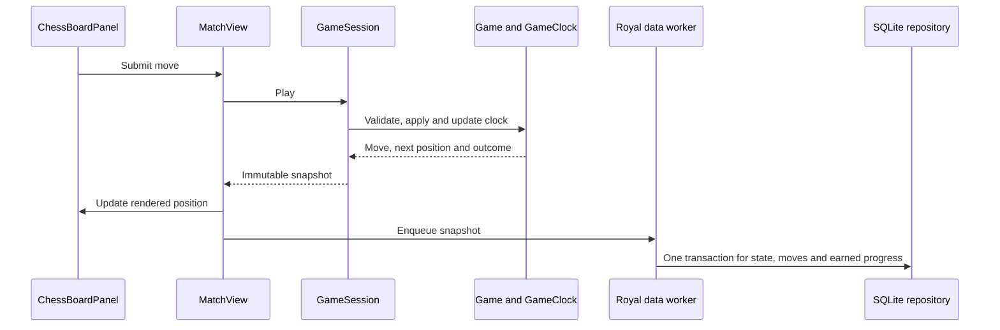

# Architecture

`com.jiexiangtech:royal-chess` is the Maven reactor. All Java packages are rooted at
`com.jiexiangtech.chess`.

| Module | Responsibility |
| --- | --- |
| Domain | Immutable Position, Move, Piece, Outcome, legal generation, SAN, FEN, PGN and monotonic clock. Game owns history and repetition |
| Application | GameSession coordinates game and clock. MatchSnapshot is a persistence DTO. Accounts and Puzzles enforce their respective rules. ChessStore and ChessEngine are ports |
| Infrastructure | Versioned SQLite migration, repository, transaction boundary, PBKDF2, built-in searches and optional UCI subprocess |
| Desktop | Main assembles dependencies. RoyalFrame owns navigation and account state. MatchView, ReplayView and PuzzleView coordinate their board views |

Infrastructure depends on application and application depends on domain. Domain can run by itself.
Desktop depends on application and infrastructure to assemble and use implementations.

## Live command path

Queries for profile and history are independent of the board and use a data executor.
Swing components receive completion callbacks on the EDT. Search workers hold immutable
positions and discard their result when canceled or when the active position changes.
Java2D rendering reads buffered images and current view state. Window-local timers drive
clocks, animation and playback and stop when their views close.

SQLite retains one timestamped snapshot per game. Reconstruction replays its legal UCI moves from
the original FEN, compares derived SAN and FEN with persisted values, then restores clocks
and an external result such as a resignation. Guest play uses a dedicated local profile.
