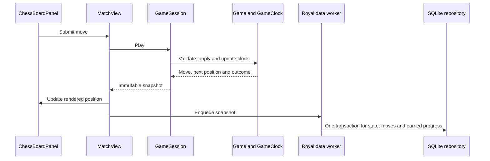

# Architecture

`com.jiexiangtech:royal-chess` is the Maven reactor. All Java packages are rooted at
`com.jiexiangtech.chess`.

| Module | Responsibility |
| --- | --- |
| Domain | Immutable Position, Move, Piece, Outcome, legal generation, SAN, FEN, PGN and monotonic clock. Game owns history and repetition |
| Application | GameSession coordinates game and clock. MatchSnapshot is a persistence DTO. Accounts and Puzzles enforce their respective rules. ChessStore and ChessEngine are ports |
| Infrastructure | Versioned SQLite migration, repository, transaction boundary, PBKDF2, built-in searches and optional UCI subprocess |
| Desktop | Main assembles dependencies. RoyalFrame owns navigation and account state. MatchView, ReplayView and PuzzleView coordinate their board views |

Infrastructure depends on application and application depends on domain. Domain can run by itself.
Desktop depends on application and infrastructure to assemble and use implementations.

## Live command path

Queries for profile and history are independent of the board and use a data executor.
Swing components receive completion callbacks on the EDT. Search workers hold immutable
positions and discard their result when canceled or when the active position changes.
Java2D rendering reads buffered images and current view state. Window-local timers drive
clocks, animation and playback and stop when their views close.

SQLite retains one timestamped snapshot per game. Reconstruction replays its legal UCI moves from
the original FEN, compares derived SAN and FEN with persisted values, then restores clocks
and an external result such as a resignation. Guest play uses a dedicated local profile.

## Graphics Architecture (Classic 2D & Royal Focus 2.5D)

All rendering and visual effects live strictly inside `chess-desktop`:

- **Strategy & Switching**: `BoardRenderer` decouples `ChessBoardPanel` interaction from rendering, delegating to either `Classic2DBoardRenderer` or `RoyalFocusBoardRenderer`. `FocusModeController` coordinates live switching between Classic 2D and Royal Focus 2.5D without altering `GameSession` state or clocks, while persisting `Preferences.ViewMode` and `Preferences.GraphicsQuality` asynchronously to SQLite.
- **Perspective & Hit-Testing**: `PerspectiveProjection` solves the `3×3` projective homography `H` and exact inverse `H⁻¹`. `PerspectiveCoordinateMapper` calibrates the 2.5D trapezoid (`taper = 0.625`) from [ROYAL_FOCUS_MODE.md](design/ROYAL_FOCUS_MODE.md) and performs front-to-back billboard piece hitbox + inverse board-plane hit-testing across all 64 squares (supporting click-to-move, drag-and-drop, castling, en passant, promotion, flip, resize, and fullscreen).
- **Texture Warping & Piece Caching**: `PerspectiveTextureRenderer` caches the inverse-homography warped 64-square marble surface into an offscreen `BufferedImage` (rebuilt only on resize, flip, theme, or quality change). `RoyalPieceRenderer` trims alpha bounds (`alpha > 16`) and maintains an LRU Retina-scaled progressive bicubic sprite cache. `PieceDepthSorter` enforces back-to-front painter's order.
- **Cinematic Lighting & Animation**: `CinematicLightingEngine` (`SpotlightRenderer`, `VignetteRenderer`), `ShadowRenderer`, `ReflectionRenderer`, `RoyalGlowEffect`, and `RoyalAnimationEngine` (60 FPS coalesced `javax.swing.Timer` that stops automatically when idle) deliver smooth perspective move interpolation, piece lift arcs, selection bloom, check pulses, capture fade-outs, and outcome overlays with zero SQLite queries or EDT blocking.

## Online beta

The JVM server is a separate Maven module. Desktop and server share `chess-online-protocol`
records and the chess domain. The Spring Boot backend serializes moves through a
revision-checked update to the MongoDB room document. The server stores the clock deadline
alongside the resulting position. Its WebSocket stream signals new revisions, and the
desktop fetches the authoritative snapshot asynchronously.

The desktop adds a scene for online play while reusing its existing board renderers.
A separate local credential file supports returning to the most recent room per profile.
The deployment image contains the server runtime. See [Online deployment](ONLINE_DEPLOYMENT.md).
